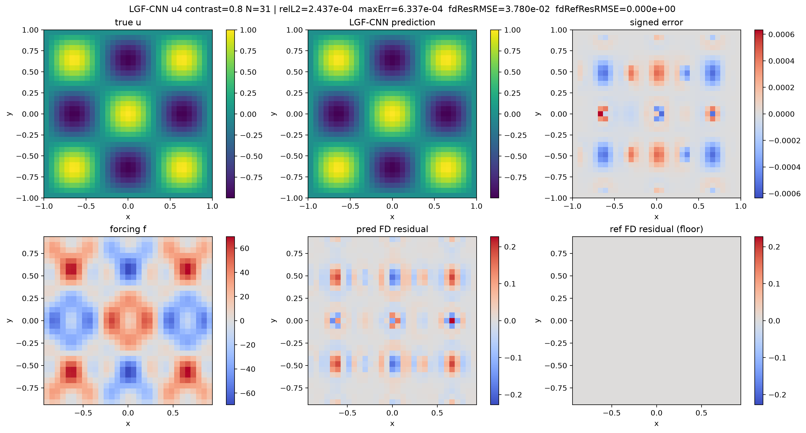

# LGF-CNN: Learned Iterative Solvers for Elliptic PDEs with Lattice Green's Functions

This repository studies neural solvers for second-order elliptic equations on $[-1,1]^2$ with Dirichlet boundary conditions:

$$-\nabla\cdot\big(a\,\nabla u\big) = f \quad \text{in } \Omega, \qquad u = g \ \text{on } \partial\Omega,$$

where the coefficient is either a spatially varying field $a(x,y)$ (linear) or a solution-dependent power $a(u)=u^k$ (nonlinear).

The main method, **LGF-CNN**, is an unrolled residual iteration. In each step, the current residual is propagated by a *fixed* bank of lattice Green's functions (LGFs) for screened Poisson operators $(-\Delta_h+\lambda_j)^{-1}$, applied exactly with the discrete sine transform. A small network made only of 1×1 convolutions learns how to mix these filtered residuals pointwise. All long-range spatial propagation comes from the physics-based LGF kernels, so the learned part stays small and the solver is sign-equivariant by construction.



## Results

Variable-coefficient problem ($N=31$, contrast 0.8, 6 LGF channels), MMS-trained model evaluated on four fixed analytic solutions u1–u4. With the same budget of 6 iterations, LGF-CNN reaches about **15–20× lower error** than an LGF-preconditioned Richardson iteration.

| Case | LGF-CNN (6 steps) rel. L2 | Richardson (6 steps) rel. L2 |
|---|---:|---:|
| u1 | **1.46e-4** | 2.46e-3 |
| u2 | **1.98e-4** | 3.69e-3 |
| u3 | **1.72e-4** | 2.28e-3 |
| u4 | **2.44e-4** | 5.04e-3 |

Reproduced with the default training command below (about 1 minute on a laptop CPU). High-accuracy PCG is also reported in the output as a converged reference.

## Repository structure

| Directory | Problem | Methods |
|---|---|---|
| [`axy_lgf/`](axy_lgf/) | $a(x,y)$, homogeneous Dirichlet | **LGF-CNN** (main package), LGF filter bank, PCG, Richardson |
| [`CNN+LGF/`](CNN+LGF/) | $a(x,y)$, general Dirichlet | LGF kernels + CNN unrolled iteration; LGF-UNet multiscale variant |
| [`a(x,y)/`](a(x,y)/) | $a(x,y)$ | CNN and U-Net baselines, PINN (Raissi et al., 2019) |
| [`a(u)=u^k/`](a(u)=u^k/) | $a(u)=u^k$, nonlinear | CNN baselines with damped-Newton reference solver |
| `LGF_python.zip` | — | Reference LGF solver used by `CNN+LGF/` (unzip next to the scripts) |

Every script supports two kinds of training data: **MMS** (sample $u$, compute $f = A_h u$) and **solver** (sample $f$, solve for $u$ with a high-accuracy solver). It also supports two losses, `--loss supervised` and `--loss physics` (discrete PDE residual).

## Quick start

Requires Python 3.10+, PyTorch, NumPy, SciPy, and Matplotlib.

```bash
# Classical solvers
python -m axy_lgf.run_demo --solver pcg
python -m axy_lgf.run_demo --solver lgf_bank

# Train and evaluate LGF-CNN
python -m axy_lgf.train_lgf_cnn --data-kind mms --loss-mode supervised \
  --domain-min -1 --domain-max 1 --epochs 120 --n 31 --K 6 --contrast 0.8

# Baselines
python "a(x,y)/Baseline_mms.py" --loss physics
python "a(x,y)/PINN.py" --case u1 --sigma 0.5 --N 128
python "a(u)=u^k/Baseline_solver.py" --loss supervised
```

The [`axy_lgf` README](axy_lgf/README.md) gives the full derivation, including the flux-form discretization, the DST-I inverse, scale-free mixer inputs, and generalization sweeps over frequency, amplitude, and coefficient contrast. It also documents the output and checkpoint layout.

## Acknowledgements
The initial version of `axy_lgf` was provided by my research advisor and extended in this repository. The PINN baseline follows M. Raissi, P. Perdikaris, and G. E. Karniadakis, *Physics-informed neural networks*, J. Comput. Phys. 378 (2019).
